# arqus — Knowledge Map

> A comprehensive reference for any agent working on the arqus codebase.

## 1. What is arqus?

A minimal terminal coding agent written in Rust, modeled on the ideas of **pi** (a reference coding agent). It features:
- A ~1000-token system prompt, four tools (`read`, `write`, `edit`, `bash`)
- Streaming LLM calls (OpenAI-compatible, OpenRouter, Anthropic)
- Append-only JSONL session files with tree-structured history and branching
- Context compaction (summarize old history, keep recent)
- A ratatui TUI with approval dialogs, command palette, themes, and a steering queue
- A print mode for scripting
- Docker sandboxing

**Version:** 0.2.0 | **License:** MIT | **Edition:** Rust 2021

---

## 2. Architecture Overview

```mermaid
flowchart TD
    subgraph "Entry Points"
        M["main.rs / cli.rs"]
    end
    subgraph "Agent Layer"
        AG["agent.rs — loop"]
        RT["runtime.rs — Runtime"]
        AS["agent_safety.rs — approval flow"]
        AU["agent_util.rs — helpers"]
    end
    subgraph "Core Logic (pure, no IO)"
        TY["types.rs — Message, Block, Entry"]
        SE["session.rs — JSONL store, tree walk"]
        CX["context.rs — build_context()"]
        CO["compaction.rs — cut point, token math"]
        CS["compaction_summary.rs — LLM summary call"]
        SP["system_prompt.rs — prompt builder"]
        RS["resources.rs — AGENTS.md, skills, prompts"]
        ST["settings.rs — config files"]
        CF["config.rs — resolved config"]
        CT["cost.rs — accounting, limits"]
        SF["safety.rs — path guard, approver"]
        SR["safety_risky.rs — risky pattern matcher"]
        SS["safety_setup.rs — wiring"]
        TR["tree.rs — tree display"]
        HM["home.rs — ARQUS_HOME"]
        DB["debug.rs — debug log"]
        AU2["auth.rs — key storage"]
        CA["catalog.rs — provider catalog"]
        MO["models.rs — model list parsing"]
        SA["state.rs — state.json"]
    end
    subgraph "LLM Layer (ai/)"
        AI["mod.rs — Llm enum, ToolDef, LlmRequest"]
        OA["openai.rs — OpenAI adapter"]
        AN["anthropic.rs — Anthropic adapter"]
        OR["openrouter.rs — OpenRouter adapter"]
        SSE["sse.rs — SSE stream parser"]
        ASSE["anthropic_sse.rs — Anthropic SSE parser"]
        MK["mock.rs — scripted fake for tests"]
        ER["error.rs — LlmError, retry policy"]
    end
    subgraph "Tools (tools/)"
        TM["mod.rs — dispatch, schemas"]
        RD["read.rs"]
        WR["write.rs"]
        ED["edit.rs"]
        BA["bash.rs"]
    end
    subgraph "TUI (tui/)"
        TU["mod.rs — event loop"]
        AP["app.rs — App state"]
        MS["msg.rs — Msg, Effect"]
        UP["update.rs — pure update()"]
        VW["view.rs — draw"]
        EF["effects.rs — effect executor"]
        KY["keys.rs — key mapping"]
        TH["theme.rs — colors"]
        OV["overlay/ — dialogs"]
        WI["widgets/ — transcript, tool cards"]
    end

    M --> AG
    M --> TU
    AG --> AI
    AG --> TM
    AG --> CX
    AG --> CO
    AG --> SF
    RT --> AG
    TU --> RT
    CX --> SE
    CX --> TY
    CO --> SE
    SP --> RS
    AI --> SSE
    AI --> ASSE
    AI --> OA
    AI --> AN
    AI --> OR
```



## 3. Dependency Direction (enforced rule)

```
types ← session, context, compaction ← ai, tools ← agent ← main, tui
```

- `ai/` and `tools/` must **never** import `session`
- `tui/` must **never** import `ai/` directly (goes through `Runtime`)

## 4. File Inventory

### Core (`src/`)
| File | Lines | Purpose |
|---|---|---|
| [types.rs](file:///Users/vaibhavpathak/Documents/arqus/src/types.rs) | 302 | Message, Block, Entry, Header — provider-neutral |
| [session.rs](file:///Users/vaibhavpathak/Documents/arqus/src/session.rs) | ~180 | JSONL store, tree walk, path_to_root |
| [context.rs](file:///Users/vaibhavpathak/Documents/arqus/src/context.rs) | 329 | build_context() — pure function |
| [compaction.rs](file:///Users/vaibhavpathak/Documents/arqus/src/compaction.rs) | 265 | Token math, cut point, compact() |
| [agent.rs](file:///Users/vaibhavpathak/Documents/arqus/src/agent.rs) | 315 | Agent loop, AgentEvent, AgentConfig |
| [runtime.rs](file:///Users/vaibhavpathak/Documents/arqus/src/runtime.rs) | ~180 | Runtime wrapping agent for TUI |
| [safety.rs](file:///Users/vaibhavpathak/Documents/arqus/src/safety.rs) | 259 | Path guard, approver, git notice |
| [safety_risky.rs](file:///Users/vaibhavpathak/Documents/arqus/src/safety_risky.rs) | ~105 | Risky command pattern matcher |
| [cost.rs](file:///Users/vaibhavpathak/Documents/arqus/src/cost.rs) | ~200 | Cost tracking, limits |
| [resources.rs](file:///Users/vaibhavpathak/Documents/arqus/src/resources.rs) | 285 | AGENTS.md, SYSTEM.md, skills, prompts |
| [settings.rs](file:///Users/vaibhavpathak/Documents/arqus/src/settings.rs) | 280 | Settings file loading |

### LLM Layer (`src/ai/`)
| File | Lines | Purpose |
|---|---|---|
| [mod.rs](file:///Users/vaibhavpathak/Documents/arqus/src/ai/mod.rs) | 288 | Llm enum, ToolDef, from_config |
| [openai.rs](file:///Users/vaibhavpathak/Documents/arqus/src/ai/openai.rs) | 323 | OpenAI-compatible adapter |
| [anthropic.rs](file:///Users/vaibhavpathak/Documents/arqus/src/ai/anthropic.rs) | 251 | Anthropic adapter |
| [openrouter.rs](file:///Users/vaibhavpathak/Documents/arqus/src/ai/openrouter.rs) | ~180 | OpenRouter adapter |
| [sse.rs](file:///Users/vaibhavpathak/Documents/arqus/src/ai/sse.rs) | 245 | OpenAI SSE parser |
| [anthropic_sse.rs](file:///Users/vaibhavpathak/Documents/arqus/src/ai/anthropic_sse.rs) | 283 | Anthropic SSE parser |
| [error.rs](file:///Users/vaibhavpathak/Documents/arqus/src/ai/error.rs) | 238 | LlmError, retry logic |

### Tools (`src/tools/`)
| File | Lines | Purpose |
|---|---|---|
| [mod.rs](file:///Users/vaibhavpathak/Documents/arqus/src/tools/mod.rs) | ~180 | Dispatch, schemas, helpers |
| [read.rs](file:///Users/vaibhavpathak/Documents/arqus/src/tools/read.rs) | ~200 | File reading with caps |
| [write.rs](file:///Users/vaibhavpathak/Documents/arqus/src/tools/write.rs) | ~120 | Atomic file writing |
| [edit.rs](file:///Users/vaibhavpathak/Documents/arqus/src/tools/edit.rs) | ~180 | Search-and-replace editing |
| [bash.rs](file:///Users/vaibhavpathak/Documents/arqus/src/tools/bash.rs) | 272 | sh -c with process group, timeout |

### TUI (`src/tui/`) — 15,768 lines total
The TUI follows the **Elm architecture** (A19):
- ONE state (`App`), ONE message type (`Msg`), pure `update()`, `view()`
- Effects are returned by `update()` and executed by the effect executor
- Overlays: connect, models, palette, help, approval, sessions, tree, theme, settings

## 5. Test Layers (A13)

| Layer | Count | What | Network |
|---|---|---|---|
| L1 unit | 563 | Pure functions, temp folders | No |
| L2 e2e | ~44 | Real binary + fake LLM server | Local only |
| L3 live | 6 | Real OpenRouter, `#[ignore]` | Yes |
| L4 evals | 13 tasks | Coding tasks with pass/fail | Yes |

**Current state:** 563 unit tests pass. E2e tests (`e2e_basic`) are **failing** — the fake LLM server connections are being refused, likely a port binding issue in this environment.

## 6. Session Format

JSONL, append-only. First line is a `Header`, subsequent lines are `Entry` objects with `id` and `parent_id` forming a tree. The leaf is always the last line of the file. Key entry types: `message`, `model_change`, `compaction`, `branch_summary`, `custom`.

Sessions live in `~/.arqus/sessions/<project-slug>/<ts>_<id>.jsonl`.

## 7. Key Concepts for Agents

- **`build_context()`** is a pure function: entries + leaf → messages. The only thing that decides what the model sees.
- **Sanitize rules**: every tool call must have a result; orphaned calls get synthetic error results.
- **Compaction**: triggered when context_tokens > context_window - reserve_tokens. Summary stored as an entry, full history stays on disk.
- **Provider adapters**: convert neutral `Message` to wire format at the edge. Provider quirks are isolated inside `ai/`.
- **Safety is guardrails, not a sandbox**. The Docker container is the real boundary.
- **The core knows nothing about the UI**. Events flow through channels.

## 8. Environment Variables

| Variable | Purpose |
|---|---|
| `ARQUS_HOME` | Override `~/.arqus` |
| `ARQUS_API_KEY` | API key for all providers |
| `ARQUS_MODEL` | Default model |
| `ARQUS_PROVIDER` | Default provider |
| `ARQUS_BASE_URL` | Override base URL |
| `ARQUS_CONTEXT_WINDOW` | Context window size |
| `ARQUS_DEBUG` | Enable debug logging |
| `ARQUS_MAX_OUTPUT_TOKENS` | Max tokens per request |
| `ARQUS_MAX_RETRIES` | Max retry attempts |
| `ARQUS_RETRY_BASE_MS` | Base retry delay |
| `ARQUS_IDLE_TIMEOUT_SECS` | Idle stream timeout |

## 9. Stages Completed

Stages 0–26 (core) + T1–T11 (TUI) = **37 stages** completed. Stage 17 and 18 are IN PROGRESS (blocked on live API key/eval baseline). The project has never been tested end-to-end with a paid model in an automated fashion.
